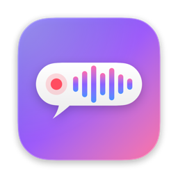
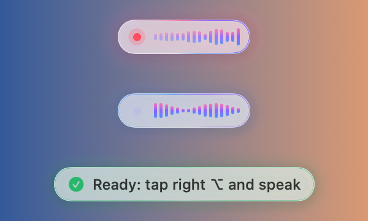

# Yap

Dictation for the Mac menu bar. Tap the right ⌥ key, speak, and the text appears in whatever field you are typing in. Speech is recognised on your Mac by Parakeet Ultra, an open speech-recognition model, so your voice never leaves it.

I built Yap for myself: I dictate a lot, and no free app had both a fast local model and an indicator I could drag out of the way.

## Install

Needs a Mac with Apple Silicon (M1 or later) and macOS 14 or later.

1. Download the DMG from the [latest release](https://github.com/mfetisov-cmd/yap/releases/latest), open it and drag Yap onto Applications.
2. Open Yap from Applications. macOS says it cannot verify the app, because Yap is not signed with a paid Apple developer certificate. Click Done, open System Settings → Privacy & Security, scroll down to the message about Yap and click Open Anyway. This is needed once per version.
3. Allow the microphone when Yap asks.
4. When macOS asks to let Yap control your computer, click Open System Settings and turn Yap on under Accessibility. Yap needs it to notice the right ⌥ key in other apps and to paste.
5. Wait for the speech model to download, about 600 MB, once. Until it is in, the menu of the waveform icon in the menu bar says it is downloading, and Yap tells you when it is ready.

To start Yap with your Mac, click the waveform icon and turn on Open at login.

## Use

| Key | What happens |
|---|---|
| Right ⌥, tapped on its own | Recording starts and a small indicator appears |
| Enter | The text is pasted, then Enter is pressed, so a chat message is sent |
| Right ⌥ again | The text is pasted, without Enter |
| Esc | The recording is dropped |

Your last eight dictations are in the waveform icon's menu, and All dictations… opens every one with search. A click copies one. You can drag the indicator anywhere, and Yap remembers the spot.

Yap recognises the 25 European languages Parakeet Ultra knows, English, German and Russian among them, without switching. Its menus are in English, or in Russian when Russian is your Mac's first language.

## Privacy

Recording and recognition happen on your Mac. Yap goes online only to download the model. Your dictations are saved in one file on your Mac, `~/Library/Application Support/Yap/history.jsonl`, and nowhere else.

## Updating

Quit Yap and install the new DMG the same way. For macOS every unsigned build is a new app, so it asks for the microphone again, and in Accessibility you remove Yap with the − button and turn it on again when Yap asks.

## Build from source

Needs the Command Line Tools (`xcode-select --install`). Xcode is not needed.

- `./package.sh` builds `dist/Yap.app` and `dist/Yap-<version>.dmg`.
- `./build.sh` installs a development copy in `~/Applications/Yap.app`. Later runs replace only the app's code, so macOS keeps its permissions; `./build.sh --launcher` reinstalls the whole app.

## Credits

- [FluidAudio](https://github.com/FluidInference/FluidAudio) runs the model on the Mac. Apache-2.0.
- [Parakeet Ultra](https://huggingface.co/moondream/parakeet-ultra) by Moondream, trained from NVIDIA's Parakeet. CC-BY-4.0.

Yap is MIT-licensed, see [LICENSE](LICENSE).
